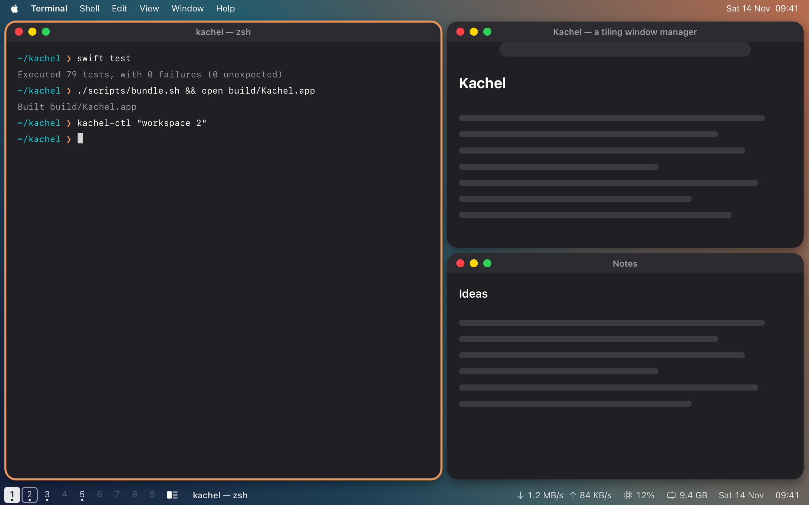
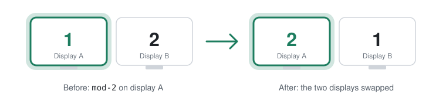

<p align="center"></p>

# Kachel

[](https://github.com/jklaiber/kachel/actions/workflows/ci.yml)
[](https://github.com/jklaiber/kachel/releases/latest)
[](https://jklaiber.github.io/kachel/)
[](LICENSE)

**Tiling windows for macOS, ready in a minute.** Windows arrange themselves
side by side as you open them, nine workspaces switch instantly, and a bar,
window search and scratchpads come built in. Set it up in a Settings window
like System Settings, or in a YAML file. No turning off SIP, no fighting with
Spaces.



If you know xmonad: the same workspace model. Nine workspaces are shared by all
displays, each display shows one of them, and `greedyView` decides what
happens when you ask for one that's already on the other display: the two
displays swap.

<p align="center"></p>

**📖 Documentation: [jklaiber.github.io/kachel](https://jklaiber.github.io/kachel/)**

## Install

Kachel runs on macOS 26 (Tahoe) or newer, on Apple Silicon and Intel Macs.

```bash
brew install --cask jklaiber/tap/kachel
```

Open Kachel and grant Accessibility; the welcome window walks you through it and
checks the macOS settings that get in the way. Quit Amethyst, yabai or AeroSpace
first. Upgrades keep the permission.

## What it does

- **Workspaces shared by all displays**, switched instantly, without macOS
  Spaces and without disabling SIP.
- **Eleven layouts**, from Tall and Three-column to BSP, a starting layout per
  workspace; drag edges to resize.
- **A bar along the bottom** of every display, in the style of the menu bar.
- **Window search** (`mod-p`), **app rules** (`mod-shift-p`) and **scratchpads**
  (`mod-s`).
- **Trackpad swipes** between workspaces, mouse drag-to-swap, focus border.
- **A settings window** like System Settings, and a shortcut overview when you
  hold `mod`.
- **A `kachel` command** for scripts, launchers and other bars: run any
  command, ask where everything is as JSON, or follow every change.
- **Dependable**: workspaces survive a restart, a crash puts windows back and
  starts Kachel again, a hung app doesn't hold it up.
- Everything lives in `~/.config/kachel/config.yaml`; the settings window
  writes into it with your comments kept.

## Kachel and the others

| | Kachel | AeroSpace | yabai | Amethyst |
|---|---|---|---|---|
| Turn off SIP | never | never | for some features | never |
| Workspaces | its own, instant | its own, instant | macOS Spaces | macOS Spaces |
| Tiling | master and stack, 11 layouts | i3's tree | BSP, stack, float | master and stack |
| Bar | built in | bring your own | bring your own | none |
| Set up in | a settings window or YAML | a TOML file | a shell script | a preferences window or YAML |
| Command line, events | yes | yes | yes | no |

Each is good at what it sets out to do. Kachel is for you if you like
xmonad's master-and-stack tiling and want everything in one app that you can
set up without a config file. Switching? See
[Coming from…](https://jklaiber.github.io/kachel/coming-from/).

## What Kachel does with its permission

Kachel needs Accessibility, the permission that lets an app move other apps'
windows. Here's what it does with it, and what it doesn't:

- **Windows**: it reads where your windows are, their size and their title,
  and moves and resizes them. From the Dock it reads the red numbers on app
  icons, for the bar's badges. Nothing else in your apps.
- **Keys**: shortcuts go through macOS's hotkey system, which tells Kachel
  only about its own key combinations. Otherwise Kachel notices *that* you
  pressed a key, not which one: that's how it tells a focus change of yours
  from one an app makes. Only with `mod` set to just the left (or right)
  Option key does it look at each keypress, to see whether it's one of your
  shortcuts. Keys are never written down or sent anywhere.
- **Titles stay private**: window titles never reach the log, only a tag
  that changes every time Kachel starts. Your user name is written as `~`. To
  put windows back after a restart, Kachel keeps a hash of each title, never
  the title itself. After a crash, Kachel offers to open a GitHub issue with
  the details filled in, for you to read before you send it: no titles, no
  files.
- **Network**: one request an hour to GitHub for the latest version, with
  nothing about you or your Mac. Off in Settings → About. No tracking, no
  analytics.
- **Your windows are safe**: quitting puts every window back on screen. If
  Kachel crashes, a small helper does the same and starts Kachel again.
- **Gone without a trace**: `brew uninstall --zap kachel` also removes the
  config, the saved state and the log.

The name: *Kachel* is German for tile, as in a *Kachelofen*, the tiled stove
in the icon: nine glazed tiles for nine workspaces.

## A few keys

`mod` is Option by default.

| Key | Action |
|---|---|
| `mod-1` … `mod-9` | show workspace N here (swap displays if needed) |
| `mod-shift-1` … `9` | move the window to workspace N |
| `mod-j` / `mod-k` | focus next / previous window |
| `mod-shift-j` / `mod-shift-k` | swap with next / previous window |
| `mod-h` / `mod-l` | narrower / wider master |
| `mod-shift-space` | next layout |
| `mod-p` | search windows |
| `mod-tab` | back to the previous workspace |

All of them are in the [keys page](https://jklaiber.github.io/kachel/keys/).
Coming from xmonad, Amethyst or AeroSpace? See
[Coming from…](https://jklaiber.github.io/kachel/coming-from/).

## Build

Requires macOS 26+ and Xcode 26 (or its Command Line Tools).

```bash
swift test
./scripts/bundle.sh && open build/Kachel.app
```

More in [Development](https://jklaiber.github.io/kachel/development/); how the
code fits together is in [Architecture](https://jklaiber.github.io/kachel/architecture/).
Changes are listed in [CHANGELOG.md](CHANGELOG.md).

## Contributing

Bug reports, ideas and pull requests are welcome; see
[CONTRIBUTING.md](CONTRIBUTING.md). Questions go to
[Discussions](https://github.com/jklaiber/kachel/discussions), security problems
to [private reporting](SECURITY.md).

## Licence

[MIT](LICENSE) © Julian Klaiber
