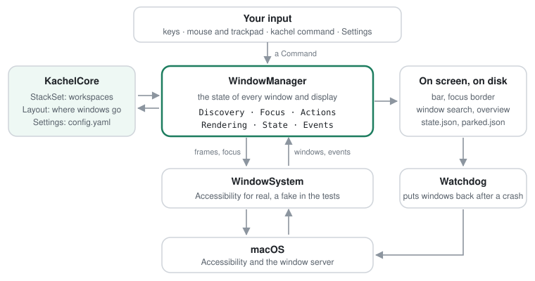

How Kachel works inside, for anyone who wants to change it. For building,
testing and releasing, see [Development](/kachel/development/).



## The idea

Kachel keeps a **model** of your workspaces (which windows are on which
workspace, in which order, with which layout, which workspace each display
shows) and makes the screen match it. Every change works the same way:

1. Something happens: you press a key, an app opens a window, a display is
   plugged in.
2. Kachel updates the model.
3. `render()` works out where every window belongs and moves the ones that
   aren't there.

The model doesn't know about macOS, and the code that talks to macOS doesn't
decide anything. That split is what makes Kachel testable, and it's the first
question to ask about any change: is this a decision (the model), or is it
talking to macOS?

## Workspaces without Spaces

macOS Spaces can't be switched reliably by another app without turning off
SIP, so Kachel doesn't use them. All windows live on one Space per display.
The windows of a workspace that isn't showing are **parked**: moved into a
corner of the screen with one pixel left on it (macOS refuses windows that
are completely off screen). Showing a workspace moves its windows back.
That's why switching is instant, and why a workspace can move to another
display, as in xmonad.

Parking has a price: if Kachel ends without cleaning up, windows stay in the
corner. The [watchdog](#things-go-wrong) exists for that.

## Two packages

| Package | What's in it | Tested by |
|---|---|---|
| `Sources/KachelCore` | Pure Swift, no AppKit: the model and every decision that doesn't need macOS. | `Tests/KachelCoreTests`, plain unit tests |
| `Sources/Kachel` | The app: the window manager, Accessibility, the bar and the windows. | `Tests/KachelTests`, against a fake macOS |

Whatever can go into KachelCore should: it's the easiest code to test and to
reason about.

### KachelCore

- **`StackSet`**: a port of xmonad's StackSet. A fixed list of workspaces, each
  with its windows in order (the first is the master), the focused one, the
  layout, the master's share, and how many masters. Each display shows exactly
  one workspace; one display is current. `greedyView`, `shift`, focus and swap
  are operations on it. It knows window IDs, not windows.
- **`Layout`**: given a layout, a number of windows and a rectangle, the
  rectangle of each window. Coordinates are Accessibility's: the origin is the
  top-left of the main display and y grows downward. Learned minimum sizes and
  per-window weights (from resizing) go in here too.
- **`Settings`**: the whole config. It parses `config.yaml` (with warnings
  for keys it doesn't know), holds the commented default config
  (`Settings.defaultYAML`), and parses commands like `workspace 3`. Its
  sibling **`ConfigEdit`** changes one value in the YAML text and keeps
  everything else as you wrote it; that's how the settings window saves.
- Smaller pieces: `Rules` (app rules), `Navigation` (which window is to the
  left), `WindowSearch` (matching and ordering in window search),
  `WindowMemory` (recognising windows after a restart), `ShortcutList` (the
  shortcut overview), `LayoutIcon` (the bar's layout pictures), `Screens`
  (pinning workspaces to displays), `CrashReport`, `Version`.

### The app

**`WindowManager`** owns the state and is split across files by job:

| File | Its job |
|---|---|
| `WindowManager.swift` | the state, start-up, applying settings, quitting |
| `+Discovery` | finding windows: Accessibility notifications, the poll, `refresh()` (which windows exist now), new windows and rules |
| `+Rendering` | `render()`: tiling, parking, floating windows, displays coming and going, the bar's content |
| `+Actions` | `perform(_ command:)`: one function per command |
| `+Focus` | keeping focus where you expect it, also when apps or macOS move it |
| `+Mouse` | drag to swap, resizing with the mouse, focus follows mouse, trackpad swipes |
| `+Scratchpads`, `+Search` | scratchpads, window search, app rules from the picker |
| `+State` | saving and restoring the workspaces, putting windows back |
| `+Command`, `+Events` | the `kachel` command: commands, queries, `subscribe` |
| `+Overlays` | the shortcut overview, the focus border |

Around it:

- **`WindowSystem`** (`WindowSystem.swift`, `AX.swift`): every question
  `WindowManager` asks macOS goes through this protocol. `AXWindowSystem` and
  `AXWindow` are the real ones, using Accessibility and the window server.
  The tests swap in `FakeWindowSystem`.
- **Input**: `HotKeys` (shortcuts), `Gestures` (trackpad), `Ctl` (the
  `kachel` command's socket), and the settings window. They all end up as a
  `Command` passed to `perform`.
- **Output**: `Bar`, `FocusBorder`, `WindowSwitcher` (window search),
  `RulePicker`, `ShortcutOverview`, `SettingsWindow`, `WelcomeWindow`.
- **Safety**: `Watchdog`, `CrashPrompt`, `UpdateCheck`, `Log`.

## What happens when…

### …you press a key

`HotKeys` registers every shortcut from the config with macOS's hotkey
system (Carbon's `RegisterEventHotKey`), which needs no permission and
swallows the key. Only with `mod` set to one side (`left-alt`) does it use an
event tap instead, because the hotkey system can't tell left Option from
right. Either way the key arrives as a `Command`:

```
key → HotKeys → perform(.greedyView(2)) → ss.greedyView(2) → render()
```

`render()` parks the windows of workspaces that are no longer showing, tiles
the visible ones, focuses the right window, updates the bar, and schedules a
check and a save.

### …an app opens a window

Kachel watches every app with an Accessibility observer. A notification
(window created, closed, moved, focused) schedules a `refresh()` 50 ms later,
so a burst of notifications becomes one refresh. `refresh()` lists the
windows that exist, compares them with the model and adds or removes windows:
a new one goes onto a workspace (the current one, or the one a rule names),
or floats if it's a dialog. Then `render()`.

Apps don't always send notifications, so a poll every 2 seconds is the safety
net. To keep it cheap it first asks the window server, which answers for
all windows at once, whether anything on screen changed, and only then asks
every app (and in any case every 10 seconds).

### …macOS doesn't do what Kachel asked

Apps can refuse a size, move a window on their own, or hang. Kachel deals
with that in a few places:

- **The verify pass**: 0.3 seconds after tiling, Kachel checks that each
  window is where it was sent and asks once more. A window that still doesn't
  fit has a minimum size; Kachel remembers it and tiles around it.
- **Fighting back, gently**: an app that moves its own tiled window is put
  back, at most a few times a minute, so Kachel never fights an app forever.
- **Hung apps**: every app gets its own queue for Accessibility calls, and a
  listing waits at most 0.3 seconds for all of them together
  (`AppResponsiveness`). An app that doesn't answer keeps its last known
  windows and is checked again in the background; it never holds up Kachel or
  other apps.
- **Tab switches**: native tabs (Finder, Terminal) show up as separate windows.
  A window that appears exactly where one of the same app just disappeared
  takes its place.

### …you change a setting

`Config` checks `config.yaml` once a second and reloads it when it changes;
`applySettings()` then rebinds keys, updates workspaces and layouts, and
places the bar. The settings window works through the same file: it changes
the text with `ConfigEdit`, writes it and reloads at once. If the result
doesn't parse, it puts the previous file back. So the file is always the one
source of truth, whether you edit it or Settings does.

### …things go wrong

- **Saved state**: a second after every change, the workspaces are saved to
  `~/Library/Application Support/Kachel/state.json`. Window IDs survive a
  restart of Kachel, so the next start puts every window back on its
  workspace. After a reboot IDs start over, so windows are recognised by app
  and title hash instead.
- **The watchdog**: Kachel starts a small second process of itself
  (`Kachel --watchdog`). Kachel keeps `parked.json` up to date with every
  window it has moved out of sight. If Kachel ends without quitting (a crash,
  Force Quit, `kill -9`), the watchdog puts those windows back on screen and
  starts Kachel again. A signal handler can't do that reliably, which is why
  it's a separate process.
- **Crash reports**: after a crash, `CrashPrompt` reads macOS's report and
  offers to open a GitHub issue with the function names filled in; nothing
  about your windows.

## Threads

Almost everything runs on the **main thread**: the model, `render()`, the bar.
That keeps the state simple: no locks. The exceptions only gather information
and hand it back to the main thread:

- listing windows: one background queue per app (`AppResponsiveness`)
- the `kachel` command's socket and `subscribe`'s writes
- reading Dock badges and running your own bar widgets' commands

## Tests

The tests are the reason the split above exists:

- **`Tests/KachelCoreTests`**: the model, layouts, config parsing and editing,
  with no macOS at all.
- **`Tests/KachelTests`**: the real `WindowManager`, started with
  `headless: true` against `FakeWindowSystem` (made-up apps, windows and
  displays) and `FakeClock` (made-up time). A test opens windows, presses
  keys with `run("workspace 2")`, plugs displays in and out, makes an app
  hang, and checks where everything ended up. Nothing on your screen moves.
- **`UITests`**: Kachel's own views drawn with made-up content and compared
  pixel by pixel with reference images.

A bug from real use is best fixed by first writing it down as a test in
`Tests/KachelTests`; most of the existing tests started that way.

## Adding things

The usual changes, and every place they touch.

### A command

1. A case in `Command` and its name in `Settings.parseCommand`
   (`Sources/KachelCore/Settings.swift`).
2. What it does: a case in `perform` (`WindowManager+Actions.swift`); the
   logic itself in `StackSet` if it changes the model.
3. Its line in the shortcut overview: `ShortcutList.swift`.
4. A default key, if it deserves one, in `Settings.defaultYAML`.
5. A test, and its row in [Keys → All commands](/kachel/keys/#all-commands).

It then works from keys and from the `kachel` command, because both parse
the same text.

### A setting

1. A property on `Settings` (or `BarSettings`), parsed in `Settings.parse`;
   add its name to the known keys so it isn't reported as unknown.
2. Its line, with a comment, in `Settings.defaultYAML`, then
   `swift run Kachel --print-default-config > config.example.yaml` (a test
   checks they match).
3. Use it: usually in `applySettings()` or where it's needed, read from
   `Config.current`.
4. A control in `SettingsWindow.swift` that writes it with `ConfigEdit`.
5. Tests for parsing (`Tests/KachelCoreTests`) and behaviour, and the docs page.

### A layout

1. A case in `LayoutKind` with its config name (`StackSet.swift`).
2. Its rectangles in `Layout.tile` (`Layout.swift`).
3. Its picture: `LayoutIcon.swift` for the bar and Settings,
   `website/src/layout-pictures.mjs` for the website.
4. A row in the table in [Layouts](/kachel/layouts/), and tests in
   `Tests/KachelCoreTests`.

### A bar widget

1. A `BarWidget` and its place in `allCases` (`Settings.swift`).
2. What it shows: a case in `segments` (`Bar.swift`), and its menu title.
3. If it needs data that changes, a timer in `Bar.place`; call `redraw()`
   when it changed. The bar redraws only when what it shows changes, so keep
   it that way.
4. Its row in [The bar](/kachel/bar/), and a look at the snapshot tests.

## Rules of thumb

- **Don't wake apps for nothing.** Every Accessibility call wakes the app
  it asks. Kachel remembers where it put each window (`expected`) and only
  sends a frame that differs. `PerformanceTests` count these calls.
- **Never fight the user or an app.** Retry a little, then accept: a minimum
  size, a window that won't move, an app that hangs.
- **Every window comes back.** Anything that moves windows out of sight must
  be undone on quit, by the watchdog and after a restart.
- **No titles in the log.** Use `Log.title(_:)` for a window's title; a test
  checks that titles never reach the log.
- **Decisions in KachelCore, with tests.** If it can be decided without
  macOS, it belongs there.
