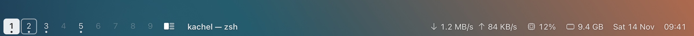

# The bar



Every display gets a second menu bar along the bottom, just above the Dock,
with the same height, font and translucency as the one at the top. Tiled
windows leave room for it.

## Workspaces

| Looks like | Means |
|---|---|
| solid | the workspace you're in |
| outline | shown on a display |
| dot | has windows |
| dim | empty |

Click a workspace to show it on that display.

With `workspaces: {window-counts: true}`, each workspace shows how many windows it has, as
a small number next to it, instead of the dot.

## Windows on this workspace

In the Full layout you only see one window. The `title` widget can show the
others, set under `title:`:

| `windows:` | Shows |
|---|---|
| `tabs` | every window's name, the focused one highlighted; click a tab to switch to it |
| `dots` | one dot per window, the focused one filled |
| `position` | which window and how many, next to the layout: `Full 2/4` |
| `off` | only the focused window's title |

`only-in-full: true` (the default) shows them only in the Full layout,
including `toggle-fullscreen`; in the other layouts you see the windows anyway.
**Settings → Bar** has the same choices under the `title` widget, with a preview.

## Widgets

| Widget | Shows | Click |
|---|---|---|
| `workspaces` | see above | show it on this display |
| `layout` | Tall, Wide, … | |
| `title` | the focused window on that display | |
| `network` | ↓ / ↑ throughput | Activity Monitor |
| `cpu` | CPU load | Activity Monitor |
| `memory` | memory used | Activity Monitor |
| `battery` | battery level, like the menu bar's icon; a bolt while plugged in, red below 10 %. `battery: {percentage: false}` shows the icon only. Not shown on Macs without a battery | Battery settings |
| `date`, `clock` | in the format of `date: {format: …}`, `clock: {format: …}` | Calendar |
| `badges` | unread counts from the Dock icons (Slack, Mail, Outlook, …), with the app's icon; only while there's a number | the app |
| your own | the first line of a command (see below) | its `click` command |

```yaml
bar:
  # The bar as a whole
  enabled: true
  height: auto                 # same as the menu bar, or a number
  font-size: 13
  background: transparent      # or blur
  appearance: auto             # white or black text depending on the wallpaper
  make-way-for-dock: true      # fade out while a hidden Dock slides up

  # Which widgets, in order
  left: [workspaces, layout, title]
  right: [badges, network, cpu, memory, battery, date, clock]

  # Each widget's own options (leave a block out for its defaults)
  workspaces:
    hide-empty: false
    window-counts: false
  title:
    windows: tabs              # position, dots, tabs or off
    only-in-full: true
  stats:
    interval: 2                # seconds between cpu / memory / network updates
  battery:
    percentage: true           # false: icon only
  date:
    format: "EEE d MMM"
  clock:
    format: "HH:mm"
  badges:
    apps: []                   # bundle IDs or names; [] = every app with a badge
```

## Unread counts

`badges` shows the red numbers of the Dock icons in the bar, with the app's
icon: unread messages in Slack, mails in Mail or Outlook, and so on. Kachel
reads them from the Dock every few seconds, so it works for any app that shows
a badge, without scripts. Nothing unread, nothing shown. Click one to go to
that app. To show only some apps, in that order:

```yaml
bar:
  badges:
    apps: [com.tinyspeck.slackmacgap, Microsoft Outlook]
```

## Your own widgets

A widget of yours shows the first line a shell command prints, in the bar's
style. **Settings → Bar → Your Widgets** adds and edits them (name, command,
interval, icon, click), and they're placed like the built-in widgets. In the
file, define it under `widgets:` and put its name in `left` or `right`:

```yaml
bar:
  right: [vpn, badges, cpu, clock]
  widgets:
    vpn:
      run: "scutil --nc status 'Work VPN' | head -1"   # a shell command
      interval: 10                                        # seconds, at least 2
      icon: lock.fill                                     # an SF Symbol, optional
      click: "open -a 'Cisco Secure Client'"              # optional
```

- The command runs with `/bin/sh`; tools from Homebrew or Nix need your login
  shell: `run: "zsh -lc 'mytool status'"`.
- It's stopped after 2 seconds, and only the first 40 characters of its first
  line are shown. Nothing printed: nothing shown.
- It only runs while the widget is in the bar.

With the Dock set to hide automatically (recommended), it slides up over the
bar when you move the pointer to the bottom edge. `make-way-for-dock` fades the
bar out on that screen while the Dock is there, and back in once it hides again.
Set it to `false` to keep the bar in place.

**Settings → Bar** shows the same: the appearance, then each side's widgets in
order with their options beneath them. Drag a widget by its grip to reorder it,
also to the other side, or right-click it.

Right-click the bar for **Show in Bar** (switch widgets on and off), Settings,
the shortcut overview, the welcome window, Reload Config, Edit Config, Show
Log, Re-tile and Quit.

Problems (no Accessibility permission, a config error, a hotkey another app
has taken) show up in the bar in orange.

`menubar-icon: true` adds the same menu as an icon to the top menu bar.
