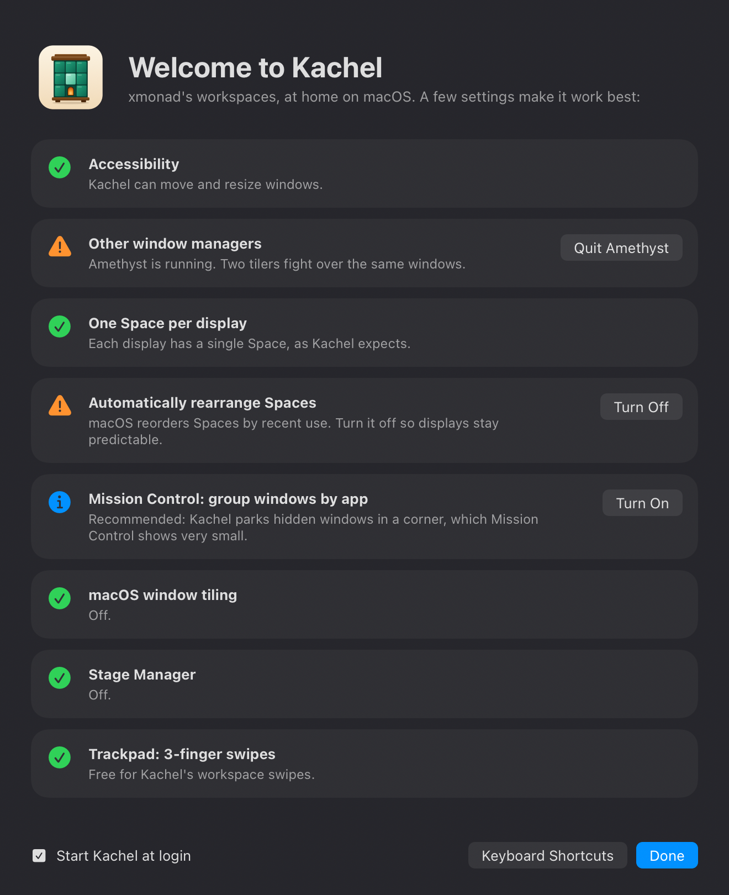

# Getting started

## Install

```bash
brew install --cask jklaiber/tap/kachel
open -a Kachel
```

Or download `Kachel-<version>.zip` from the
[releases](https://github.com/jklaiber/kachel/releases) (one app for Apple Silicon
and Intel) and move `Kachel.app` to `/Applications`. Requires macOS 13 or newer;
macOS 26 adds Liquid Glass.

## Upgrade

```bash
brew update && brew upgrade --cask kachel
```

`brew update` first: without it, Homebrew may not know about a release from the
last day yet and says the latest version is already installed. Which version you
have: **About Kachel** in the bar's right-click menu, Settings → General, or
`/Applications/Kachel.app/Contents/MacOS/Kachel --version`.

!!! note "Accessibility after every update"
    Kachel isn't signed with a paid Apple Developer ID, so macOS treats each
    version as a new app and asks for Accessibility again after an upgrade.
    If an old entry is listed but doesn't work, remove it with **–** and add
    Kachel again.

## The welcome window

On first launch, Kachel opens a welcome window:



1. **Accessibility**: click *Open Settings* and switch Kachel on. Kachel starts
   managing windows the moment it's granted.
2. **The setup check** looks at the macOS settings that matter for a tiling
   window manager. Fix what's orange:
    - **Other window managers**: quit Amethyst, AeroSpace, yabai or Rectangle;
      two tilers fight over the same windows.
    - **One Space per display**: remove extra desktops in Mission Control.
    - **Automatically rearrange Spaces**: off.
    - **Mission Control: group windows by app**: on, so parked windows don't
      look tiny there.
    - **macOS window tiling** and **Stage Manager**: off.
    - **Trackpad swipes**: if you use Kachel's swipes, turn macOS's horizontal
      swipe between full-screen apps off.
3. **Start Kachel at login**, if you like.

You can open it again any time: right-click the bar → *Welcome and Setup Check…*.

## The first five minutes

The default modifier, `mod`, is **Option** (⌥).

| Try | What happens |
|---|---|
| Hold **⌥** for a moment | every shortcut, grouped |
| **⌥1** … **⌥9** | show a workspace |
| **⌥⇧1** … **⌥⇧9** | send the focused window to a workspace |
| **⌥J** / **⌥K** | focus the next / previous window |
| **⌥⇧Space** | next layout |
| **⌥P** | search all open windows |
| **⌥S** | a terminal scratchpad |

Then open **Settings…** from the bar's right-click menu, or edit
`~/.config/kachel/config.yaml` directly; both apply immediately. See
[Settings and config.yaml](settings.md).

!!! tip "Swiss, German and French keyboards"
    With `mod: alt`, ⌥+digit no longer types characters like `# [ ] | { }`.
    If you need them, use `mod: ctrl+alt`.
