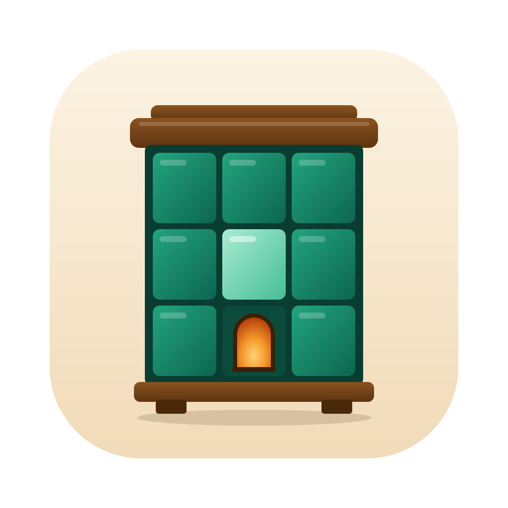
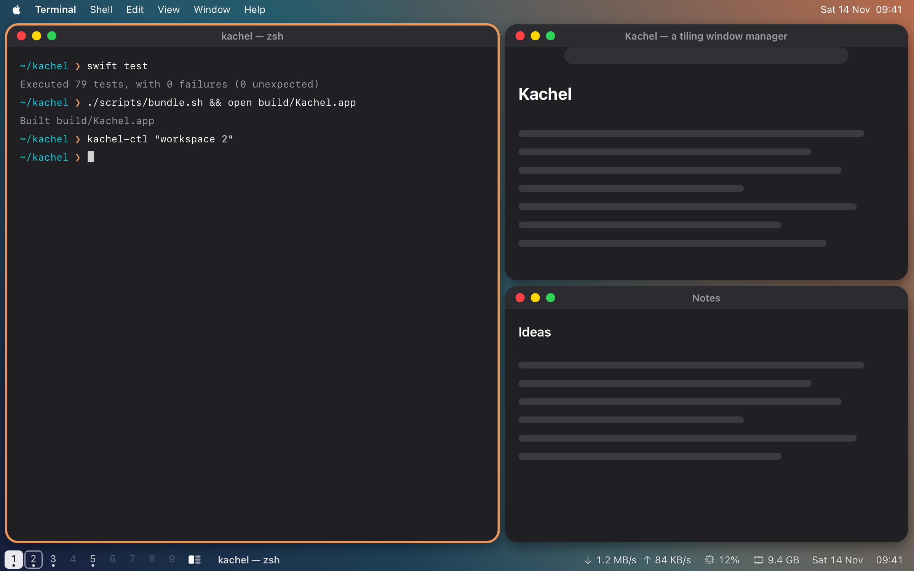

<p align="center" markdown>{ width="128" }</p>

# Kachel

A native tiling window manager for macOS with **xmonad's workspace model**:
nine workspaces shared by all displays, each display showing one of them, and
`greedyView`. Press `mod-2` while workspace 2 is on the other display, and the
two displays swap.



*Kachel* is German for tile, as in a *Kachelofen*, the tiled stove in the icon:
nine glazed tiles for nine workspaces.

## Install

```bash
brew install --cask jklaiber/tap/kachel
```

Then open Kachel: a welcome window walks you through the Accessibility
permission and checks your macOS settings. See [Getting started](getting-started.md).

## What it does

- **[Workspaces and displays](workspaces.md)**: xmonad's workspaces on any number of
  displays, back and forth, pinning workspaces to a display. No macOS Spaces needed.
- **[Layouts](layouts.md)**: Tall, Wide, Three-column, Column, Full; resize the
  master and every window in a column, with keys or the mouse.
- **[Keys](keys.md)**: an xmonad/Amethyst-style keymap, an overview when you hold
  `mod`, and every command bindable.
- **[The bar](bar.md)**: a second menu bar at the bottom of each display with
  clickable workspaces.
- **[Window search and app rules](window-search-and-rules.md)**: jump to any window
  by typing; send apps to their workspace automatically.
- **[Scratchpads](scratchpads.md)**: a terminal or quick notes on one key, over
  any workspace.
- **[Mouse and trackpad](mouse-and-trackpad.md)**: swipe between workspaces, drag
  to swap and resize, focus follows the pointer.
- **[Settings](settings.md)**: a settings window like System Settings, writing
  the same `config.yaml` you can edit by hand.

## Why not Spaces?

macOS Spaces belong to one display each and can't be driven reliably without
disabling SIP. Kachel, like AeroSpace, keeps one Space per display and parks the
windows of hidden workspaces in a screen corner instead. Switching is instant,
and workspaces move freely between displays. More in
[Workspaces and displays](workspaces.md#how-hiding-works).
