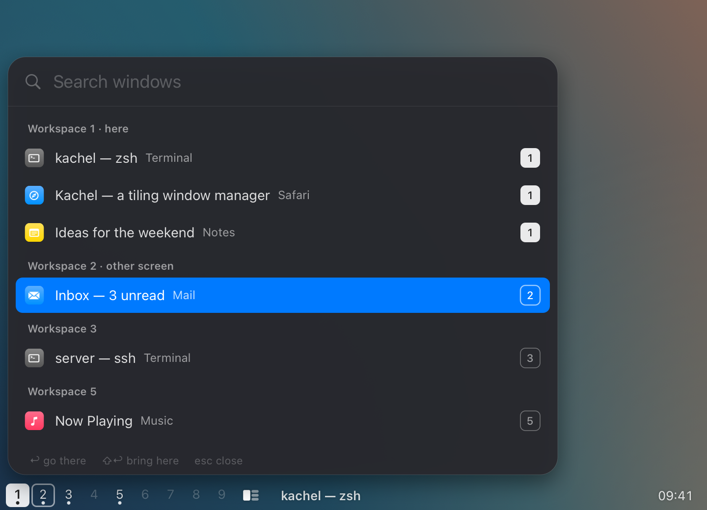
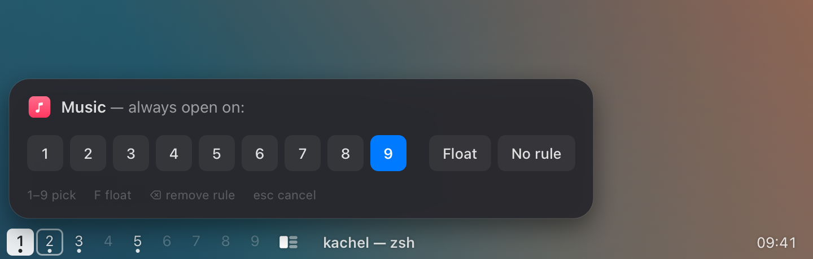

# Window search and app rules

## Window search

`mod-p` opens a search over every open window, on every workspace and display.

{ width="49%" }
{ width="49%" }

- Before you type, it lists everything by workspace, with the window you used
  before already selected: `mod-p` then ↩ jumps back.
- Typing filters by app and title, forgiving typos of order: `vsh` finds
  "VS Code — home-stack".
- **↩** goes to the window (its workspace comes to this display), **⇧↩** brings
  the window to you, **esc** closes.

## App rules

Like xmonad's `manageHook`: where an app's windows open, and whether they float.

`mod-shift-p` on any window opens a picker: press **1–9** for the workspace,
**F** to float, **⌫** to remove the rule. Or in **Settings… → App Rules**, or by hand:

```yaml
rules:
  - app: com.tinyspeck.slackmacgap   # bundle ID or app name
    workspace: 9
  - app: Calculator
    float: true
  - app: com.google.Chrome
    title: Meet                      # only windows whose title contains this
    workspace: 5
```

Rules apply when a window appears; you can still move it afterwards.



## Floating windows

These float instead of being tiled:

- windows matched by a rule with `float: true`, or listed under `floating:`
- dialogs: windows without a fullscreen button (`float-dialogs: true`)
- windows smaller than `float-small-windows` points (off by default)
- windows that can't be resized

`mod-t` floats or tiles the focused window by hand.
