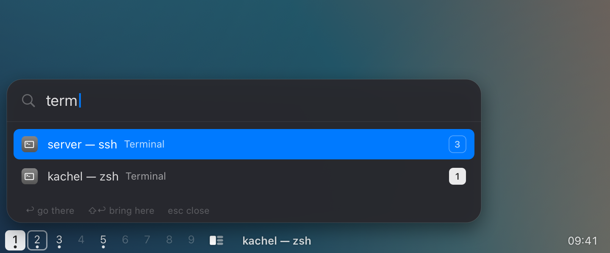

# Window search and app rules

## Window search

`mod-p` opens a search over every open window, on every workspace and display.

{ width="49%" }
{ width="49%" }

- Before you type, it lists everything by workspace, with the window you used
  before already selected: `mod-p` then ↩ jumps back.
- Typing filters by app and title, forgiving typos of order: `vsh` finds
  "VS Code — home-stack".
- **↩** goes to the window (its workspace comes to this display), **⇧↩** brings
  the window to you, **esc** closes.

## App rules

Like xmonad's `manageHook`: where an app's windows open, and whether they float.

`mod-shift-p` on any window opens a picker: press **1–9** for the workspace,
**F** to float, **⌫** to remove the rule. Or in **Settings… → App Rules**, where
every rule can be changed, including its window title, or by hand:

```yaml
rules:
  - app: com.tinyspeck.slackmacgap   # bundle ID or app name
    workspace: 9
  - app: Calculator
    float: true
  - app: com.google.Chrome
    title: Meet                      # only windows whose title contains this
    workspace: 5
  - app: Mail
    title-not: Inbox                 # every window except ones with this in the title
    float: true
```

`title-not` takes one text or a list: `[Inbox, Drafts]`.

Rules apply when a window appears; you can still move it afterwards.

### Calls: minimize instead of hiding

Teams, Zoom and Webex show a small call window when the meeting window is out
of sight, but only if it's minimized or on another Space. Kachel normally moves
windows of hidden workspaces into a corner, which these apps don't notice.
`hide: minimize` minimizes the window instead while its workspace is out of
sight, and restores it, in its old place and size, when you come back:

```yaml
rules:
  - app: com.microsoft.teams2        # Microsoft Teams: every meeting window,
    title-not: [Microsoft Teams, teams.microsoft.com]   # whatever it's called
    hide: minimize
  - app: us.zoom.xos                 # Zoom (title not verified yet)
    title: Zoom Meeting
    hide: minimize
  - app: Cisco-Systems.Spark         # Webex: without a title, every Webex window
    hide: minimize
```

- The app's small window stays on screen on every workspace.
- Clicking it (or the window in the Dock) takes you back to the meeting's workspace.
- Windows you minimize yourself stay minimized.
- Teams names a meeting window after the meeting ("Daily stand-up"), and its
  main window "Microsoft Teams" or "teams.microsoft.com/…". So the rule above
  takes every Teams window except the main one, whatever the meeting is called.
- `title` and `title-not` are matched each time, so a window that only becomes
  a meeting later is covered. See a window's title with `scripts/kachel-ctl dump` (written to the log).

In **Settings → App Rules** this is the **Minimize** switch.


## Floating windows

These float instead of being tiled:

- windows matched by a rule with `float: true` (System Settings, Calculator and
  Archive Utility by default)
- dialogs: windows without a fullscreen button (`float-dialogs: true`)
- windows smaller than `float-small-windows` points (off by default)
- windows that can't be resized

`mod-t` floats or tiles the focused window by hand.
